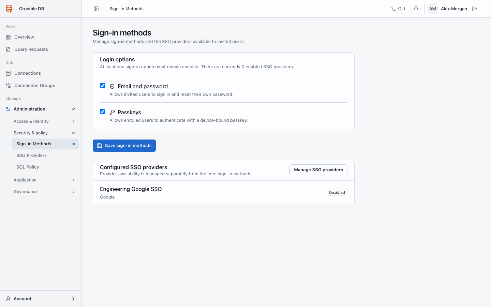
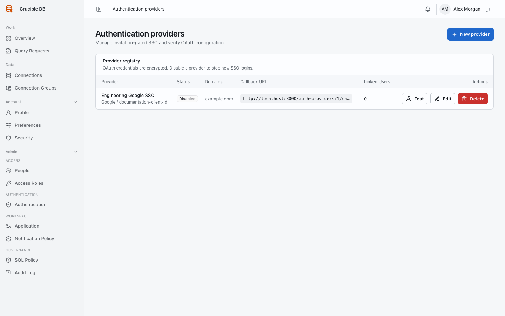

# Sign-in methods and SSO providers

**Who sees it:** workspace administrators under **Manage → Administration → Security & policy**.

{ .docs-screenshot }

## Sign-in methods

Open **Sign-in Methods** to control **Email and password** and **Passkeys** independently. Configured SSO providers are summarized here, while their credentials and lifecycle are managed on the separate **SSO Providers** page. Do not disable every viable method or create an unrecoverable administrator lockout. The server rejects a configuration that would leave no enabled login path.

## SSO providers

Open **SSO Providers** to configure Google, GitHub, Microsoft, or a generic **OpenID Connect (OIDC)** provider. Every provider has client credentials, allowed domains, scopes, enablement state, and a callback URL. Microsoft can also use a tenant. A generic OIDC provider additionally requires its issuer URL. Test the provider redirect before making SSO the only login path.

{ .docs-screenshot }

Provider configuration is invitation-gated: an SSO identity must match an invited account. Enabling a provider does not create public registration.

After a user has linked an identity, that same enabled provider can confirm protected account actions, including the user's first passkey registration. This confirmation does not create or reset a local password.

Allowed-domain restrictions are enforced after the provider returns a trusted email identity. Google requires a verified email claim, GitHub uses a verified email from the configured scope, Microsoft uses the trusted directory principal email, and generic OIDC requires trusted `sub`, `email`, and verified-email claims. Provider errors return to the login page without linking an identity.

### Generic OpenID Connect

Use **OpenID Connect (OIDC)** for any standards-compliant issuer, including self-hosted identity services. Create a confidential web application at the provider, enter the issuer URL that publishes its discovery document, then copy the client ID and client secret. Register the callback URL shown by Crucible DB at the identity provider. Keep the default `openid profile email` scopes unless the provider requires additional identity scopes.

The issuer must publish discovery, authorization, token, user-info, and JWKS endpoints. It must return a stable subject, an email address, and an email-verification claim. This keeps account linking invitation-gated and provider-agnostic.

Use **Test** on a provider before enabling it as the only login path. Testing validates the redirect and callback configuration without attaching the administrator's identity to a normal login.

Client secrets are encrypted and not returned after storage. Use your identity provider's rotation process when replacing a secret.
